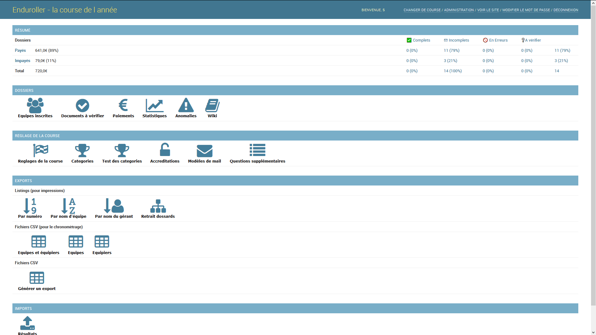

### 
#### **Enduroller.fr est un site pour aider les organisateurs à gérer les inscriptions des participants.**

###### Sommaire (les articles sans lien restent à rédiger) :
- Présentation enduroller

- [Création d'une course](creation-dune-course.md)

- [Paramètres de la course](parametres-de-la-course.md)

- [Paramètrer les catégories](categories.md)

- Gérer les dossiers

- [Questions supplémentaires](questions-supplementaires.md)

- [Mails](mails.md)

- [Composition page équipe](composition-page-equipe.md)

- [Multipaiement](multipaiement.md)

- Vérification documents et inscriptions

- Edition de listings

- Import des résultats

- Création d'un challenge

- [Procédure création compte stripe](procedure-creation-stripe.md)

- [Bon à savoir](bon-savoir.md)

- [FAQ à destination des personnes souhaitant s'inscrire à une course](faq-pour-inscriptions.md) 

